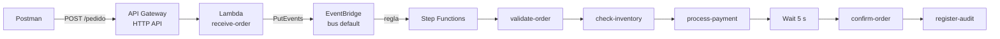
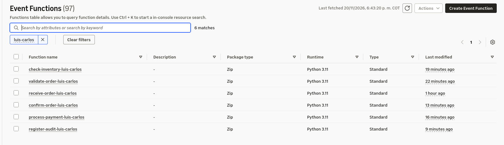
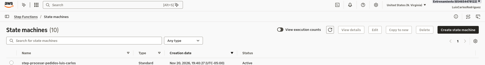
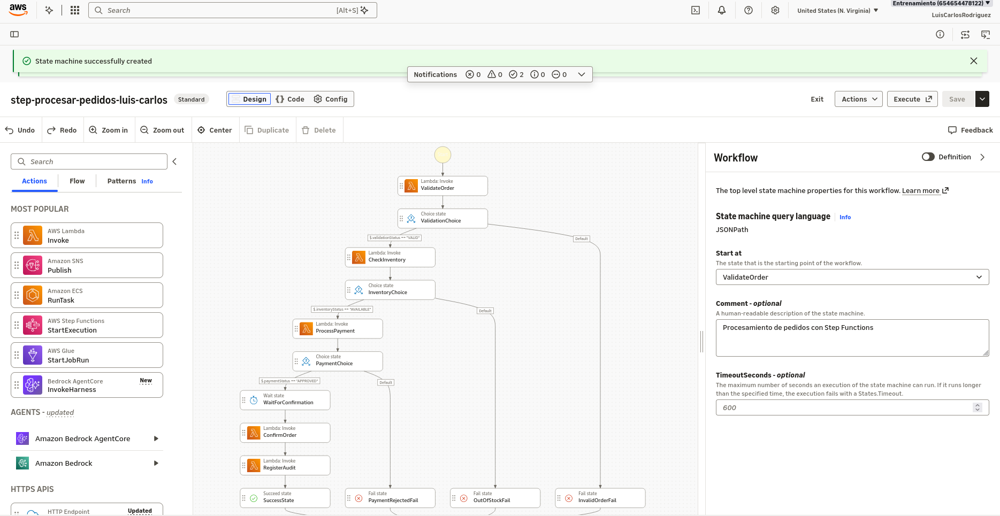
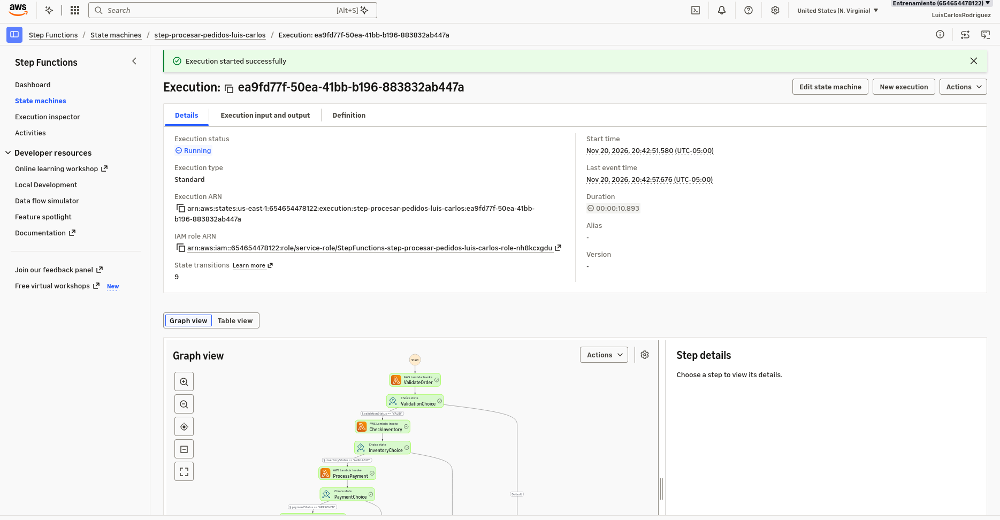
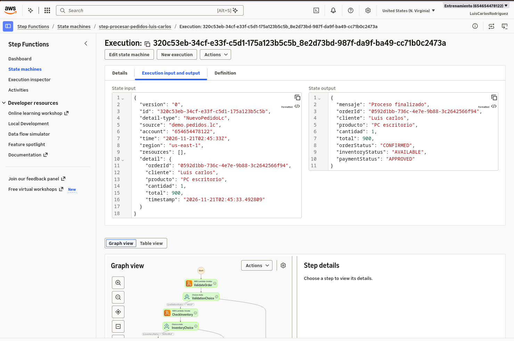
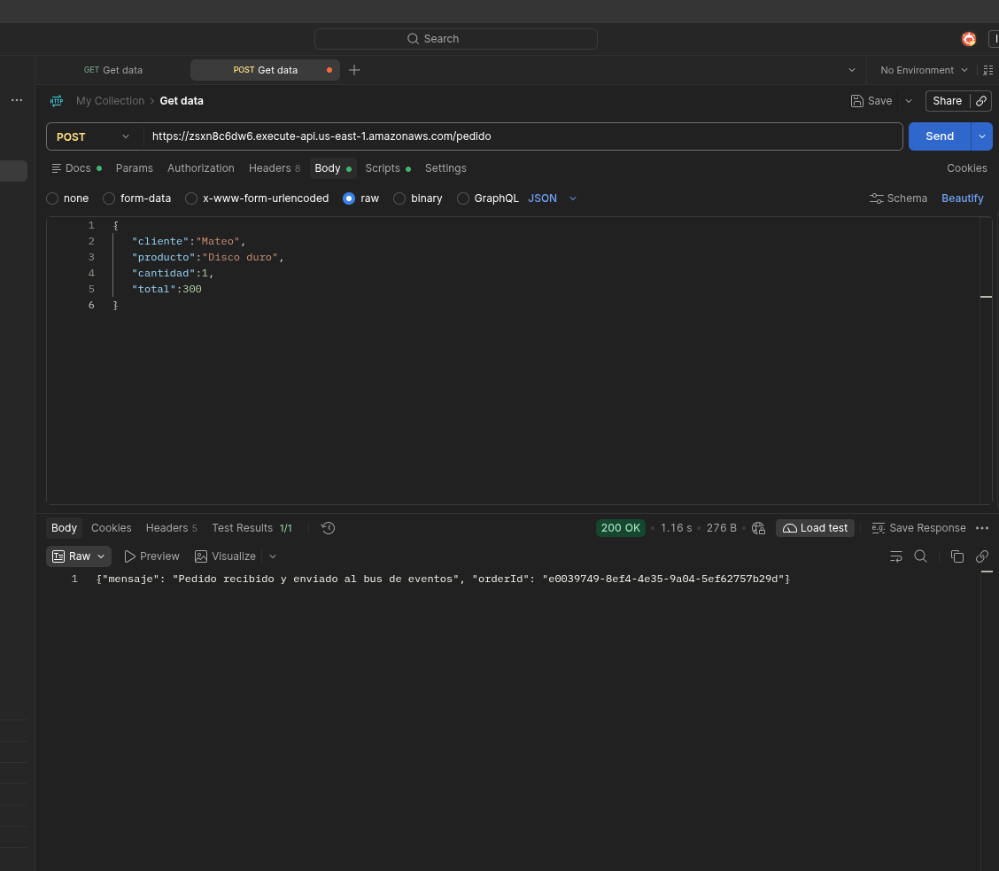
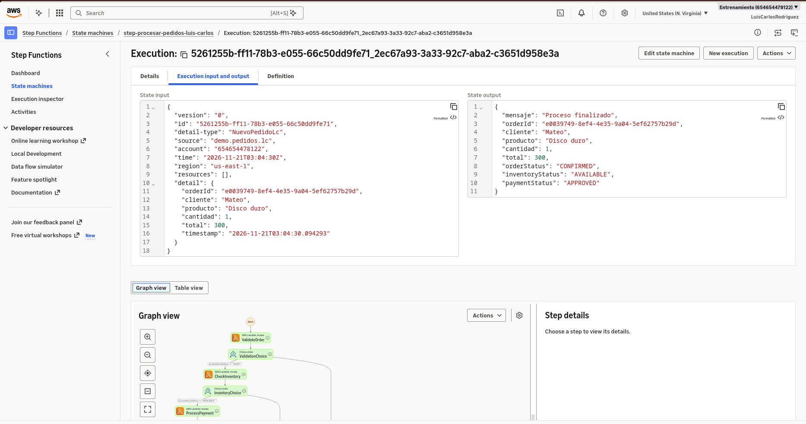

# Laboratorio AWS: automatización de pedidos con API Gateway, EventBridge y Step Functions

Laboratorio del curso de Amazon Web Services con BeTek.
Autor: Luis Carlos Rodríguez

## Descripción

Este laboratorio automatiza el procesamiento de pedidos con servicios serverless de AWS. Un cliente envía un pedido por HTTP, el sistema lo publica como evento y una máquina de estados lo valida, revisa el inventario, procesa el pago, lo confirma y deja un registro de auditoría.

**Servicios usados:** API Gateway (HTTP API), Lambda (Python 3.11), EventBridge, Step Functions (Standard), IAM y CloudWatch Logs.

## Arquitectura



La máquina de estados tiene tres salidas de error: `InvalidOrderFail` (pedido inválido), `OutOfStockFail` (sin inventario) y `PaymentRejectedFail` (pago rechazado).

## Recursos creados (región us-east-1)

| Servicio | Recurso |
|---|---|
| Lambda | `receive-order-luis-carlos` |
| Lambda | `validate-order-luis-carlos` |
| Lambda | `check-inventory-luis-carlos` |
| Lambda | `process-payment-luis-carlos` |
| Lambda | `confirm-order-luis-carlos` |
| Lambda | `register-audit-luis-carlos` |
| Step Functions | `step-procesar-pedidos-luis-carlos` (Standard) |
| EventBridge | `rule-nuevo-pedido-luis-carlos` (bus default) |
| API Gateway | HTTP API con la ruta `POST /pedido` hacia `receive-order-luis-carlos` |

Todas las Lambdas usan Python 3.11 y un rol con permisos básicos de ejecución. A `receive-order` se le agregó una política inline con `events:PutEvents`, y la Step Function y la regla de EventBridge usan los roles que la consola generó automáticamente.

## Reglas de negocio

| Lambda | Qué hace |
|---|---|
| `receive-order` | Recibe el cuerpo de API Gateway, genera un `orderId` y publica el evento en EventBridge |
| `validate-order` | Valida `cliente` y `producto` no vacíos, `cantidad > 0` y `total > 0` |
| `check-inventory` | Con `cantidad <= 5` hay stock (`AVAILABLE`); si no, `OUT_OF_STOCK` |
| `process-payment` | Con `total <= 1000` aprueba el pago (`APPROVED`); si no, `REJECTED` |
| `confirm-order` | Marca el pedido como `CONFIRMED` |
| `register-audit` | Devuelve el resumen final del pedido |

## Evento y regla de EventBridge

`receive-order` publica el evento con estos valores personalizados:

| Campo | Valor |
|---|---|
| `Source` | `demo.pedidos.lc` |
| `DetailType` | `NuevoPedidoLc` |
| `EventBusName` | `default` |

La regla `rule-nuevo-pedido-luis-carlos` filtra con este patrón, que debe coincidir con los valores de arriba:

```json
{
  "source": ["demo.pedidos.lc"],
  "detail-type": ["NuevoPedidoLc"]
}
```

El destino de la regla es la state machine `step-procesar-pedidos-luis-carlos`. La entrada se deja como evento completo, por eso `validate-order` lee los datos dentro de `detail`.

## Evidencias

### 1. Lambdas creadas

Las seis funciones con el sufijo `luis-carlos`, todas en Python 3.11.



### 2. State machine

La máquina de estados `step-procesar-pedidos-luis-carlos`, tipo Standard, y su grafo con el flujo completo y las tres salidas de error.




### 3. Ejecución directa de la Step Function

Ejecución iniciada manualmente desde la consola. La captura se tomó mientras estaba en curso, durante la pausa de 5 segundos del estado `WaitForConfirmation`.



### 4. Ejecución disparada por EventBridge

El pedido de `Luis carlos` (`PC escritorio`, cantidad 1, total 900) llegó a la Step Function a través de EventBridge: la entrada trae el sobre del evento (`source`, `detail-type`, `detail`). La salida muestra el pedido confirmado.

Salida de la ejecución:

| Campo | Valor |
|---|---|
| `mensaje` | Proceso finalizado |
| `orderStatus` | `CONFIRMED` |
| `inventoryStatus` | `AVAILABLE` |
| `paymentStatus` | `APPROVED` |



### 5. Prueba de extremo a extremo con Postman

Petición `POST` a la ruta `/pedido` de la API, con este cuerpo:

```json
{
  "cliente": "Mateo",
  "producto": "Disco duro",
  "cantidad": 1,
  "total": 300
}
```

- **Respuesta de la API:** `200 OK`, con el mensaje `Pedido recibido y enviado al bus de eventos` y el `orderId` del pedido.
- **Resultado en Step Functions:** una ejecución nueva con el mismo `orderId`, que termina con `orderStatus: CONFIRMED`, `inventoryStatus: AVAILABLE` y `paymentStatus: APPROVED`.




## Contenido del repositorio

```
.
├── README.md
├── laboratorio-aws-pedidos.pdf  
├── state_machine.json        definición de la Step Function
├── lambdas/
│   ├── receive_order.py
│   ├── validate_order.py
│   ├── check_inventory.py
│   ├── process_payment.py
│   ├── confirm_order.py
│   └── register_audit.py
└── evidencias/               capturas de las pruebas
```

## Cómo reproducirlo

1. Crear las seis Lambdas (Python 3.11, rol básico), pegar el código de `lambdas/` y pulsar **Deploy** en cada una.
2. Agregar al rol de `receive-order` una política inline con `events:PutEvents`.
3. Crear la state machine Standard con `state_machine.json`, reemplazando región y número de cuenta en los ARN por los propios.
4. Crear la regla de EventBridge con el patrón de la sección anterior y la state machine como destino.
5. Crear una HTTP API con la ruta `POST /pedido` integrada con `receive-order`.
6. Enviar un pedido con Postman y revisar la ejecución en Step Functions.

## Problemas encontrados

- **La Lambda devolvía `Hello from Lambda!`.** Era el código de ejemplo: faltó pulsar **Deploy** tras pegar el código. La Step Function fallaba en `ValidationChoice` porque la salida de `validate-order` no traía `validationStatus`. Con el despliegue hecho, el flujo corrió completo.
- **Datos en `null` al probar `receive-order` desde la consola.** La función espera el pedido como texto dentro del campo `body`, igual que lo entrega API Gateway. Con un JSON plano, los campos llegan vacíos.

## Limpieza

Después de documentar las pruebas se recomienda eliminar los recursos para evitar costos: la API, la regla de EventBridge, la state machine, las seis Lambdas, los roles de IAM creados automáticamente y los grupos de logs de CloudWatch.
